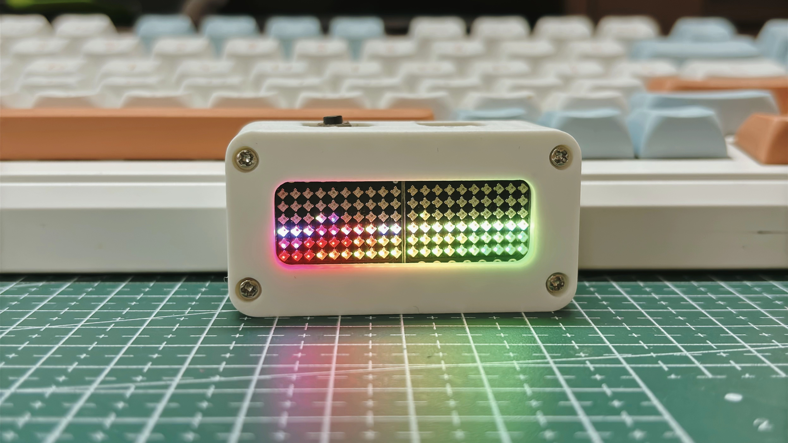
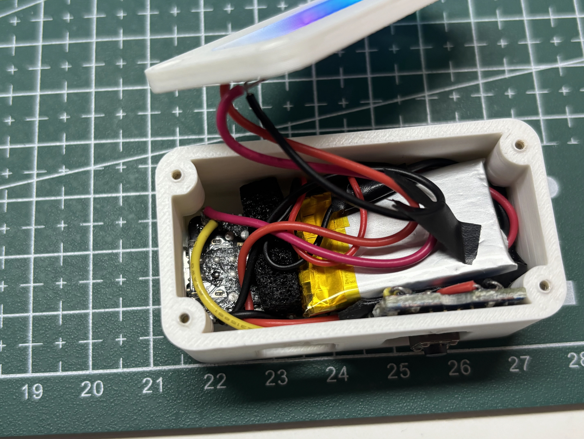
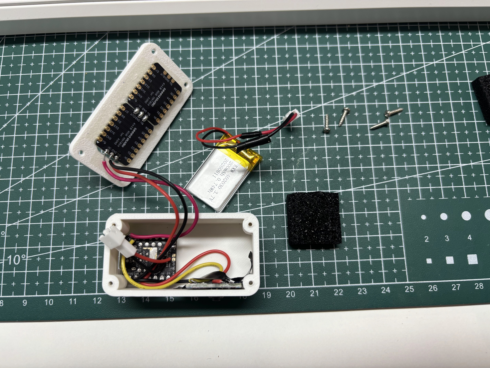

# IMU Electronic Ocean

[English](README.md) | [中文](README_CN.md)

A handheld electronic ocean built with a XIAO STM32C5, its onboard LSM6DS3TR-C IMU, and two chained 6 × 10 RGB matrices. The 120 LEDs form one 6 × 20 display: tilt the enclosure and the waterline follows gravity; move it faster and the waves become more energetic.

## Demo video and photos

[](https://www.youtube.com/shorts/ZSBuj6kjqKk)

[Watch the demo on YouTube Shorts](https://www.youtube.com/shorts/ZSBuj6kjqKk)

| Finished build | Inside the enclosure | Parts before assembly |
|---|---|---|
|  |  |  |

## Features

- One continuous, approximately half-filled ocean across both matrices, including their seam
- Gravity-aligned waterline with a pair of animated ripples and motion-responsive wave strength
- Five display modes: animated neon, breathing ocean blue, breathing cyan, breathing purple, and a scrolling text marquee
- IMU motion interrupt or a two-second button hold to wake from the LED-off state
- Short button press to switch modes; two-second hold or deliberate flick to turn the LEDs off
- Automatic LED-off state after 90 seconds without a significant orientation change
- 20 ms target frame interval (up to approximately 50 frames per second; actual rate is not measured)
- Brightness limited to 3% in the firmware

## How it works

The firmware treats both panels as one rectangular container. Each frame, it reads the IMU, filters the projected gravity direction, and uses that direction to place a water surface across the full 6 × 20 matrix. Two sine waves add ripples; accelerometer and gyroscope activity increase their amplitude. The fill threshold is recalculated so roughly half the display stays covered even when the device is turned. In the LED-off state, the application waits for an IMU motion interrupt or a long button press.

The LED-off state is a software standby, **not** MCU deep sleep or a hard power switch. USB CDC remains available for development and reflashing; battery current has not been characterized.

## Hardware and wiring

| Part | Connection | Purpose |
|---|---|---|
| XIAO STM32C5 onboard LSM6DS3TR-C | I2C2; INT1 on PC13 | Orientation, motion, and wake interrupt |
| First 6 × 10 WS2812-compatible RGB matrix | DIN to D0 / PA0 | RGB data |
| Second 6 × 10 RGB matrix | DIN to first matrix DOUT | Daisy chain; 120 pixels total |
| Grove Button V1.3 | Signal to D1 / PA1; common GND | Mode switching and long-press control |

Mount both panels upright with the same orientation, first panel above the second. The first panel's DIN is the start of the chain. Power the two matrices from an appropriate supply and connect their ground to the controller's ground. Do not draw the full matrix current from a GPIO pin. The enclosure and panel orientation used by the firmware are described in `software/src/main.c`; a different mounting may require changing the screen-axis signs or pixel mapping.

## Controls

| Action | Result |
|---|---|
| Power on | LEDs off; waits for wake |
| Deliberate movement while off | IMU interrupt wakes the display |
| Hold D1 for 2 seconds while off | Wakes the display |
| Tilt while running | Water follows gravity |
| Move while running | Waves respond to motion |
| Short press D1 while running | Cycles through five modes |
| Hold D1 for 2 seconds while running | LEDs off |
| Deliberate flick while running | LEDs off, after a 3-second post-wake guard |
| Keep orientation nearly unchanged for 90 seconds | LEDs off |

## Build and flash

The PlatformIO project is entirely inside [`software/`](software/). In VS Code, use **Open Folder** on `software/`, not the repository root or `3d/`. The enclosure files and photos sit outside the PlatformIO project.

Install PlatformIO Core or the PlatformIO extension for VS Code, with the Seeed Studio platform and its `seeed-xiao-stm32c5` board support. This project uses the Zephyr framework.

```bash
git clone https://github.com/lewuq/IMU_Electronic_Ocean.git
cd IMU_Electronic_Ocean
pio run -d software
pio run -d software -t upload
```

The generated UF2 is at `software/.pio/build/seeed-xiao-stm32c5/firmware.uf2`. You can also copy the UF2 through the board's bootloader if your setup supports it. The RGB signal is generated in software on D0, so no NeoPixel library is needed.

## 3D printable enclosure

The source 3MF contained four separate meshes. They are exported as individual, millimetre-scale STL files in [`3d/`](3d/), with each part placed on the build plane:

| Version | Front | Rear |
|---|---|---|
| v1 | [`v1_ocean_front_42x14_landscape.stl`](3d/v1_ocean_front_42x14_landscape.stl) | [`v1_ocean_rear_landscape_logo.stl`](3d/v1_ocean_rear_landscape_logo.stl) |
| v2 | [`v2_ocean_front_42x14_landscape.stl`](3d/v2_ocean_front_42x14_landscape.stl) | [`v2_ocean_rear_landscape_AB.stl`](3d/v2_ocean_rear_landscape_AB.stl) |

Choose the front and rear from the **same version**. Check fit, orientation, material, and tolerances in your slicer before printing.

## Repository layout

```text
software/                   Open this folder as the PlatformIO project
  platformio.ini            Board and framework selection
  src/main.c                Ocean renderer, WS2812 output, IMU, and controls
  zephyr/                   Device tree and Zephyr configuration
3d/                         Four printable STL parts (v1 and v2)
media/                      Demo photographs used in this README
README.md                   English documentation
README_CN.md                Chinese documentation
```

## Notes

- This is a visual approximation of liquid, not a full fluid physics engine.
- WS2812 output on D0 is timed with the CPU cycle counter. The target frame interval does not guarantee a measured 50 FPS under all conditions.
- The 3D models come from the supplied 3MF project. No separate license for the model files has been specified here.
