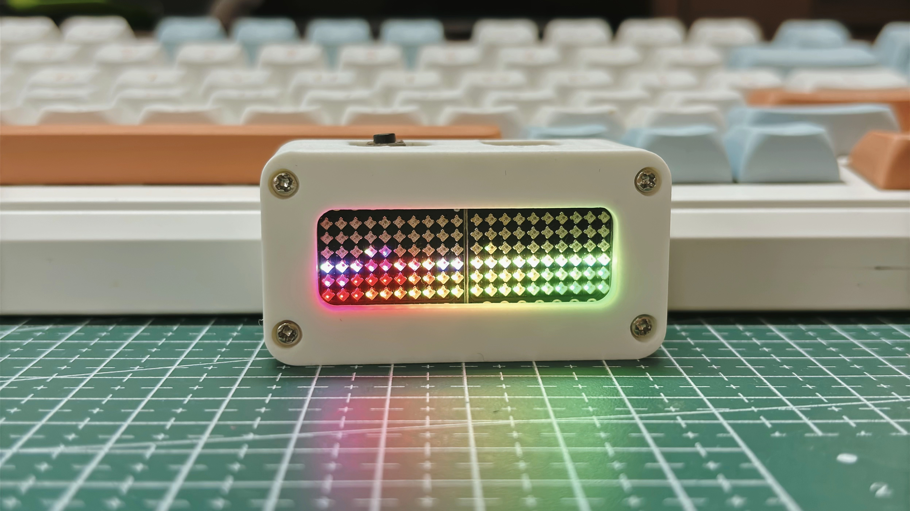
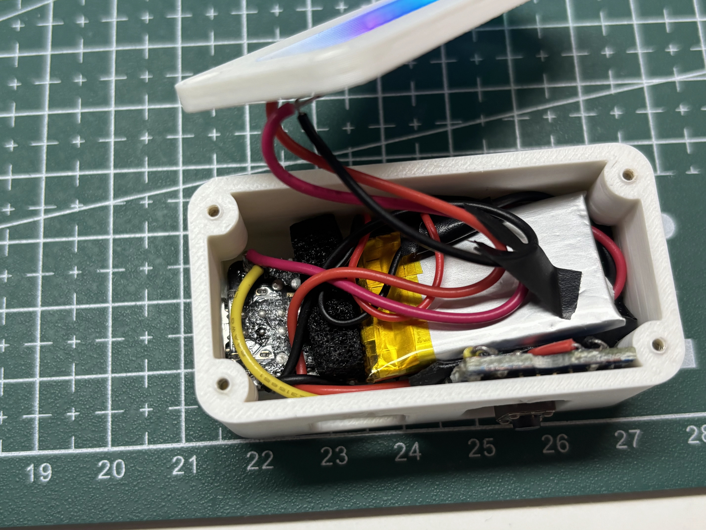
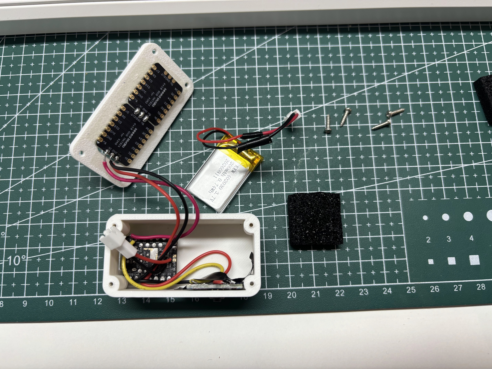

# IMU 电子海洋

[English](README.md) | [中文](README_CN.md)

这是一个手持式电子海洋项目，使用 XIAO STM32C5、板载 LSM6DS3TR-C IMU 和两块串联的 6 × 10 RGB 灯板。120 颗灯被映射为一个完整的 6 × 20 显示区域：倾斜外壳时，水面会跟随重力方向变化；移动幅度增大时，波浪也会更加明显。

## 实物演示照片

| 成品效果 | 外壳内部 | 组装前的零件 |
|---|---|---|
|  |  |  |

## 功能

- 两块灯板共同显示一片连续的海洋，水面不会在拼接处断开，填充面积约为一半
- 根据重力方向计算水面，叠加两组波纹，并随运动强度改变波浪幅度
- 五种显示模式：动态霓虹、深海蓝呼吸、天青色呼吸、紫色呼吸和滚动字幕
- IMU 动作中断或长按按键 2 秒唤醒熄灯状态
- 短按切换灯效；长按 2 秒或用力甩动后熄灯
- 姿态连续 90 秒没有明显变化时自动熄灯
- 目标画面间隔 20 ms（理论约 50 帧/秒，未实测稳定帧率）
- 固件将整体亮度限制为 3%

## 实现思路

软件把两块灯板视作一个长方形容器。每帧读取 IMU 数据，对投影到显示平面的重力方向进行平滑处理，再据此确定贯穿整个 6 × 20 区域的水面。两组正弦波产生波纹，加速度计和陀螺仪检测到的动作则增强波浪；程序同时重新计算水位，使设备旋转时仍保持约一半的“海水”面积。熄灯状态下，程序等待 IMU 动作中断或按键长按唤醒。

这里的熄灯等待属于软件待机，**不是** MCU 深度休眠或物理断电。为方便调试和重新烧录，USB CDC 保持可用；尚未测量电池供电时的实际电流。

## 硬件与接线

| 部件 | 连接 | 用途 |
|---|---|---|
| XIAO STM32C5 板载 LSM6DS3TR-C | I2C2；INT1 连接 PC13 | 姿态、运动及唤醒中断 |
| 第一块 6 × 10 WS2812 兼容 RGB 灯板 | DIN 连接 D0 / PA0 | RGB 数据 |
| 第二块 6 × 10 RGB 灯板 | DIN 连接第一块的 DOUT | 串联，共 120 颗灯 |
| Grove Button V1.3 | 信号连接 D1 / PA1；共地 | 灯效切换与长按控制 |

两块灯板应保持相同朝向，第一块位于上方，第二块位于下方；第一块的 DIN 是整条数据链的入口。为灯板提供合适的电源，并使灯板与主控共地。不要让 GPIO 引脚直接承担灯板供电电流。如果装配方向不同，可能需要修改 `software/src/main.c` 中的显示坐标符号或灯珠映射。

## 使用方法

| 操作 | 效果 |
|---|---|
| 上电 | RGB 熄灭，等待唤醒 |
| 熄灯时明显移动设备 | IMU 中断唤醒显示 |
| 熄灯时长按 D1 两秒 | 唤醒显示 |
| 运行时倾斜设备 | 水面随重力改变方向 |
| 运行时移动设备 | 波浪随动作增强 |
| 运行时短按 D1 | 依次切换五种模式 |
| 运行时长按 D1 两秒 | 熄灯 |
| 运行时用力甩动 | 熄灯；唤醒后的前三秒不触发此动作 |
| 姿态约 90 秒无明显变化 | 自动熄灯 |

## 编译与烧录

完整的 PlatformIO 工程位于 [`software/`](software/) 中。在 VS Code 中使用“打开文件夹”选择 `software/`，不要选择仓库根目录或 `3d/`；外壳和图片文件均位于 PlatformIO 工程之外。

安装 PlatformIO Core 或 VS Code 的 PlatformIO 扩展，并准备包含 `seeed-xiao-stm32c5` 板卡支持的 Seeed Studio 平台。本工程使用 Zephyr 框架。

```bash
git clone https://github.com/lewuq/IMU_Electronic_Ocean.git
cd IMU_Electronic_Ocean
pio run -d software
pio run -d software -t upload
```

编译生成的 UF2 位于 `software/.pio/build/seeed-xiao-stm32c5/firmware.uf2`。如果所用环境支持，也可通过板载引导程序复制 UF2。D0 的 RGB 时序由程序生成，不依赖 NeoPixel 库。

## 3D 打印外壳

提供的 3MF 源文件中包含四个独立模型，已分别导出为位于 [`3d/`](3d/) 的毫米单位 STL，并使每个零件贴合打印平台：

| 版本 | 正面件 | 背面件 |
|---|---|---|
| v1 | [`v1_ocean_front_42x14_landscape.stl`](3d/v1_ocean_front_42x14_landscape.stl) | [`v1_ocean_rear_landscape_logo.stl`](3d/v1_ocean_rear_landscape_logo.stl) |
| v2 | [`v2_ocean_front_42x14_landscape.stl`](3d/v2_ocean_front_42x14_landscape.stl) | [`v2_ocean_rear_landscape_AB.stl`](3d/v2_ocean_rear_landscape_AB.stl) |

请选择**同一版本**的正面件和背面件，并在切片软件中检查配合、摆放方向、材料和公差。

## 仓库结构

```text
software/                   用 PlatformIO 打开这个文件夹
  platformio.ini            板卡和框架配置
  src/main.c                海洋渲染、WS2812 输出、IMU 与按键控制
  zephyr/                   设备树和 Zephyr 配置
3d/                         四个可打印 STL（v1 与 v2）
media/                      README 使用的演示照片
README.md                   英文说明
README_CN.md                中文说明
```

## 说明

- 海洋效果是轻量的视觉模拟，不是完整的流体物理引擎。
- D0 的 WS2812 时序使用 CPU 周期计数器控制；目标帧间隔不等于已实测稳定达到 50 FPS。
- 3D 模型来自提供的 3MF 工程，此处尚未指定模型文件的独立许可证。
